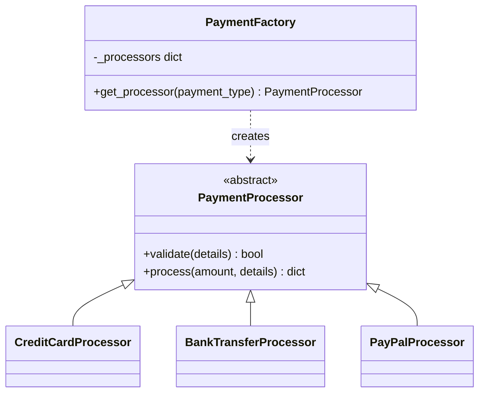
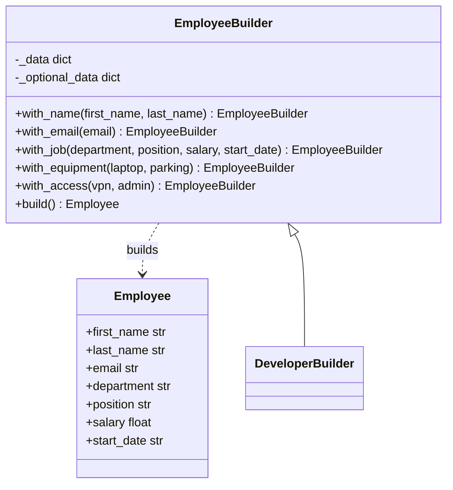
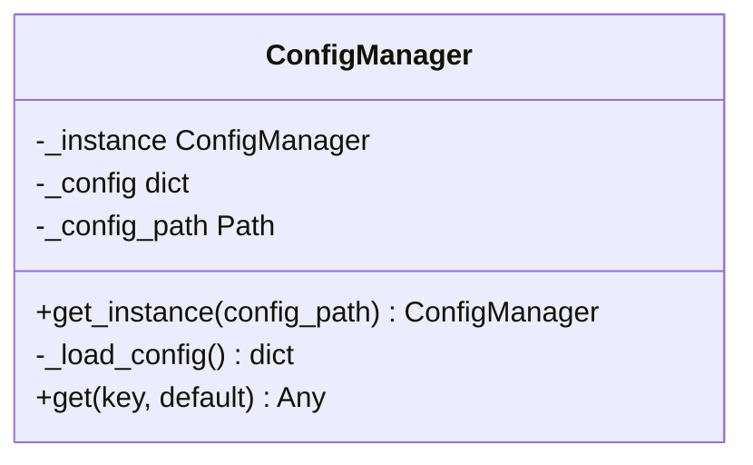

# Creational Design Patterns — Python Exercises

Solutions for the Factory, Builder, and Singleton pattern exercises. Each exercise includes a Python implementation and a Mermaid UML class diagram.

## Project structure

```text
design-pattern/
├── factory_pattern/
│   ├── __init__.py
│   └── payment.py
├── builder_pattern/
│   ├── __init__.py
│   └── employee.py
├── singleton_pattern/
│   ├── __init__.py
│   ├── config.json
│   └── config_manager.py
└── tests/
    └── test_patterns.py
```

## 1. Factory Pattern — Payment system

`PaymentProcessor` is the abstract interface. `CreditCardProcessor`, `BankTransferProcessor`, and `PayPalProcessor` implement payment-specific validation and fee calculation. `PaymentFactory` maps payment type strings to processor classes using a dictionary.



Run: `python -m factory_pattern.payment`

## 2. Builder Pattern — Employee onboarding

`Employee` stores the finished employee record. `EmployeeBuilder` offers chainable `with_...()` methods and validates required fields in `build()`. `DeveloperBuilder` extends it with developer-oriented defaults.



Run: `python -m builder_pattern.employee`

## 3. Singleton Pattern — Configuration manager

`ConfigManager.get_instance()` returns the same object each time. The JSON file is loaded once on first construction. `get()` supports nested keys in dot notation, such as `database.host`.



Run: `python -m singleton_pattern.config_manager`

## Run all tests

From the repository root:

```bash
python -m unittest discover -s tests -v
```

Only Python's standard library is required. The sample payment API key is a placeholder; do not commit real credentials.
