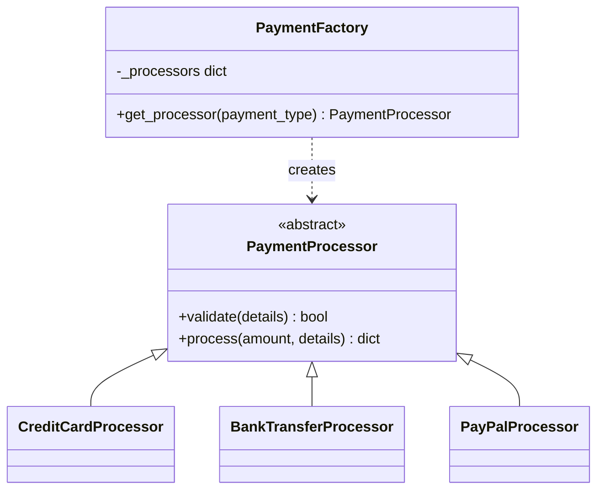
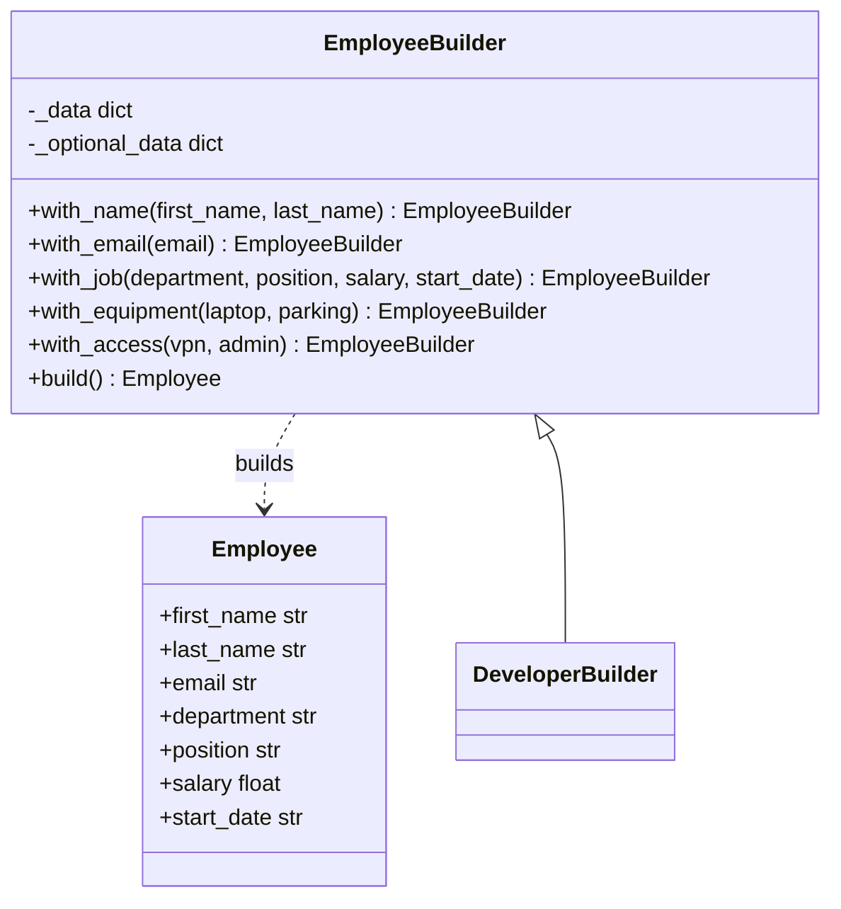
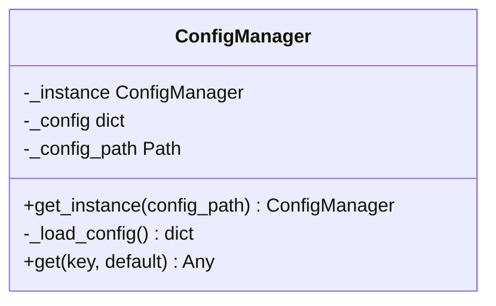
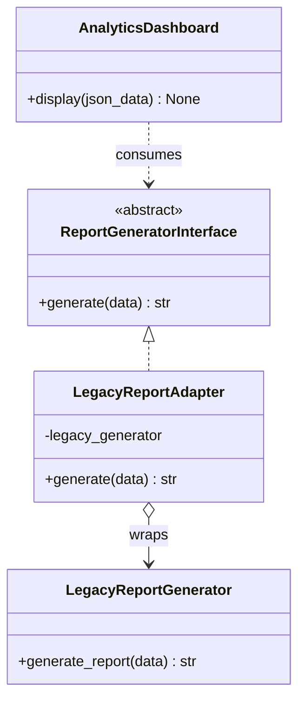
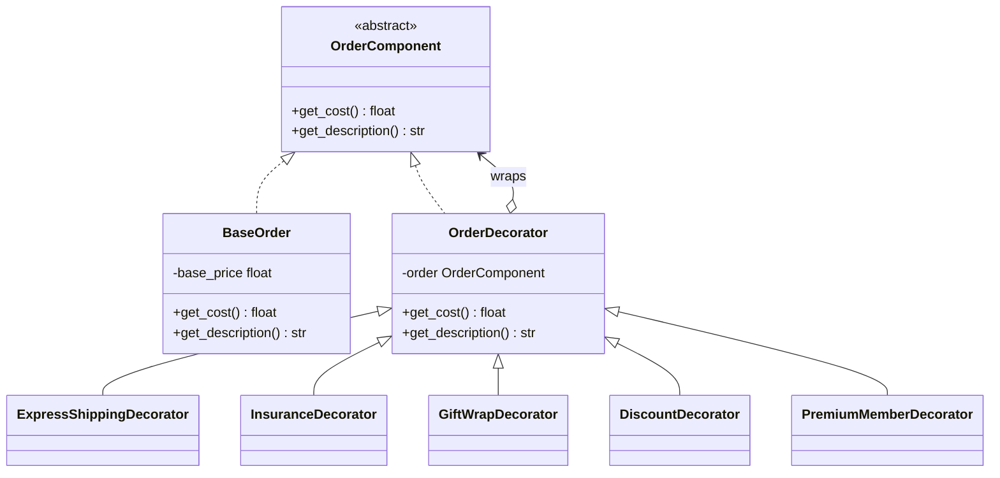
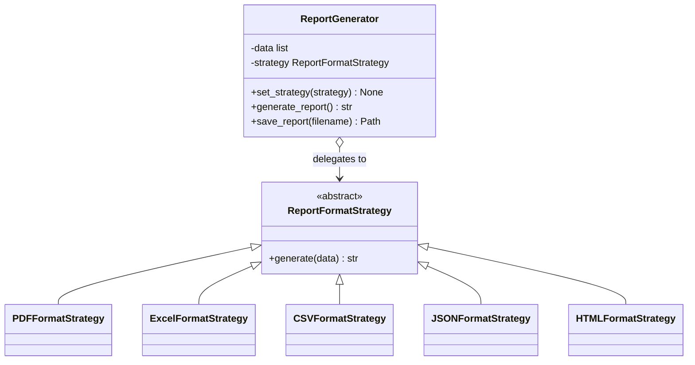
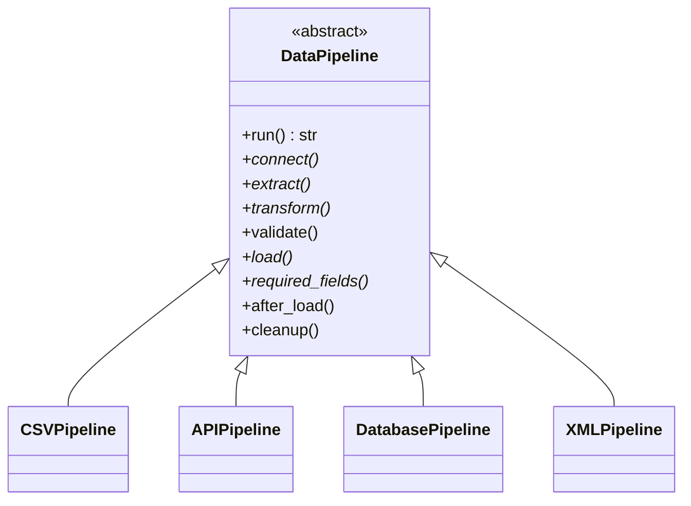

# Design Patterns — Python Exercises

Solutions for creational, structural, and behavioral design pattern exercises. Each exercise includes a Python implementation; UML class diagrams are included below.

## Project structure

```text
design-pattern/
├── factory_pattern/
│   ├── __init__.py
│   └── payment.py
├── builder_pattern/
│   ├── __init__.py
│   └── employee.py
├── singleton_pattern/
│   ├── __init__.py
│   ├── config.json
│   └── config_manager.py
└── tests/
    └── test_patterns.py
```

## 1. Factory Pattern — Payment system

`PaymentProcessor` is the abstract interface. `CreditCardProcessor`, `BankTransferProcessor`, and `PayPalProcessor` implement payment-specific validation and fee calculation. `PaymentFactory` maps payment type strings to processor classes using a dictionary.



Run: `python -m factory_pattern.payment`

## 2. Builder Pattern — Employee onboarding

`Employee` stores the finished employee record. `EmployeeBuilder` offers chainable `with_...()` methods and validates required fields in `build()`. `DeveloperBuilder` extends it with developer-oriented defaults.



Run: `python -m builder_pattern.employee`

## 3. Singleton Pattern — Configuration manager

`ConfigManager.get_instance()` returns the same object each time. The JSON file is loaded once on first construction. `get()` supports nested keys in dot notation, such as `database.host`.



Run: `python -m singleton_pattern.config_manager`

## Run all tests

From the repository root:

```bash
python -m unittest discover -s tests -v
```

Only Python's standard library is required. The sample payment API key is a placeholder; do not commit real credentials.


---

# Structural Patterns

Structural patterns organize classes and objects into flexible, maintainable structures.

## 4. Adapter Pattern — XML legacy reports to JSON

`LegacyReportGenerator` is treated as an external dependency and remains unchanged. `LegacyReportAdapter` wraps it, parses its XML output, and exposes the JSON-based `ReportGeneratorInterface.generate(data)` contract expected by clients such as `AnalyticsDashboard`.



Run: `python -m structural_patterns.adapter_pattern`

## 5. Decorator Pattern — Order pricing

`BaseOrder` implements the common `OrderComponent` interface. Each decorator wraps another component and adds one feature: express shipping, insurance, gift wrap, a percentage discount, or a premium-member discount. Decorators can be composed at runtime.



Run: `python -m structural_patterns.decorator_pattern`

---

# Behavioral Patterns

Behavioral patterns define how objects communicate and share responsibilities.

## 6. Strategy Pattern — Report generator

The `ReportGenerator` context delegates formatting to a `ReportFormatStrategy`. PDF, Excel (tab-separated exercise representation), CSV, JSON, and HTML are separate concrete strategies. Call `set_strategy()` to switch formats at runtime. HTML demonstrates adding a new format without changing the context or existing strategies.



Run: `python -m behavioral_patterns.strategy_report`

Note: PDF and Excel outputs intentionally follow the text-based representations in the supplied exercise. They are not binary PDF/XLSX documents.

## 7. Template Method Pattern — ETL pipeline

The abstract `DataPipeline.run()` method fixes the workflow: connect, extract, transform, validate, load, and run an optional hook. Shared validation and cleanup live in the base class. CSV, API, Database, and XML subclasses implement source-specific steps.



Run: `python -m behavioral_patterns.template_method_pipeline`

## Project structure

```text
design-pattern/
├── factory_pattern/
│   └── payment.py
├── builder_pattern/
│   └── employee.py
├── singleton_pattern/
│   ├── config.json
│   └── config_manager.py
├── structural_patterns/
│   ├── adapter_pattern.py
│   └── decorator_pattern.py
├── behavioral_patterns/
│   ├── strategy_report.py
│   └── template_method_pipeline.py
└── tests/
    ├── test_patterns.py
    └── test_additional_patterns.py
```

## Run all tests

From the repository root:

```bash
python -m unittest discover -s tests -v
```

Only Python's standard library is required. The payment API key in the sample config is a placeholder; never commit real credentials.
